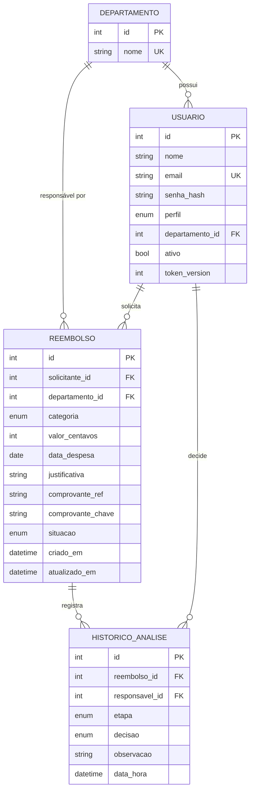
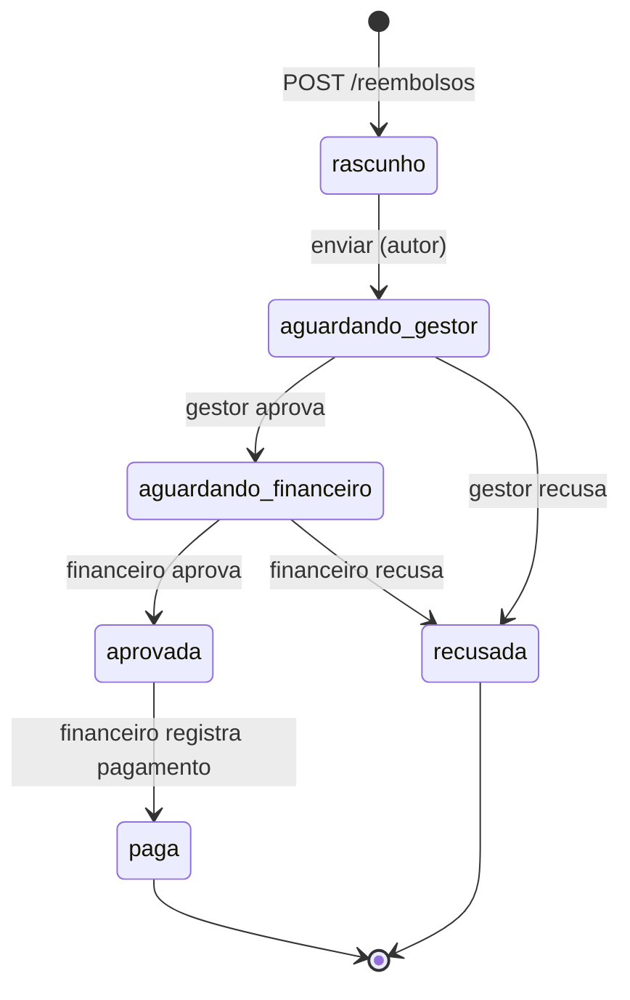

# Documentação Técnica — Plataforma de Gestão de Reembolsos Corporativos

**Atividade 07 — 2AV** · **Aluno:** Ygor da Silva Allves · **Matrícula:** 01902390

---

## 1. Descrição da solução

API REST para a NexusCorp centralizar solicitações de reembolso, substituindo planilhas e e-mails. O sistema identifica cada usuário, limita o que cada perfil enxerga e faz, impõe o fluxo de aprovação e guarda o histórico completo de decisões.

| Item | Escolha |
|---|---|
| Linguagem / framework | Python 3.12, FastAPI |
| Banco relacional | SQLite (arquivo `reembolsos.db`), via SQLModel/SQLAlchemy |
| Autenticação | JWT (HS256) assinado no servidor, com expiração e revogação |
| Senhas | `scrypt` com salt aleatório (biblioteca padrão do Python) |
| Documentação interativa | Swagger em `/docs` e ReDoc em `/redoc` |
| Testes | Pytest, banco em memória (8 cenários de homologação + regras RN01–RN15) |

**Organização do código**

```
app/
  main.py          aplicação, tratador de erros 422 sem eco de dados
  config.py        variáveis de ambiente (SECRET_KEY, DATABASE_URL...)
  database.py      engine, sessão e chaves estrangeiras ativas
  models.py        tabelas
  enums.py         perfis, categorias, situações, etapas, decisões
  schemas.py       contratos de entrada e saída (validação)
  security.py      hash de senha e JWT
  deps.py          autenticação (RN01, RN14) e exigência de perfil
  workflow.py      máquina de estados (única fonte das transições válidas)
  services.py      regras de negócio e escopo de visibilidade
  routers/         rotas: auth, usuarios, departamentos, reembolsos
  seed.py          provisionamento de usuários e dados de demonstração
tests/             testes automatizados
scripts/           gerador de evidências
docs/              esta documentação e as evidências
```

---

## 2. Modelo de dados



Há ainda a tabela `tokens_revogados` (`jti`, `expira_em`), que guarda os tokens encerrados por logout.

**Decisões de modelagem**

- **Dinheiro em centavos inteiros** (`valor_centavos`): evita erro de arredondamento. A API recebe e devolve reais (`180.0`).
- **`reembolsos.departamento_id`** guarda o departamento do solicitante no momento do registro. É com ele que se decide a responsabilidade do gestor (RN03).
- **Restrição única `(solicitante_id, comprovante_chave)`**: o banco também impede referência de comprovante repetida (RN05), mesmo em requisições concorrentes. A `comprovante_chave` é a referência normalizada (sem espaços nas pontas e sem diferença de maiúsculas/minúsculas).
- **Chaves estrangeiras ativas** (`PRAGMA foreign_keys=ON`): os vínculos usuário → departamento → solicitação → histórico são impostos pelo banco.
- **`historico_analises`** registra cada decisão com responsável, etapa, decisão, observação e data/hora (UTC). Permite recuperar o histórico completo de qualquer solicitação.
- **Datas e horas** são gravadas em UTC, com fuso.

---

## 3. Contrato das principais operações

### Padrão de respostas e códigos HTTP

| Código | Significado | Exemplo |
|---|---|---|
| 200 / 201 / 204 | Sucesso | consulta, criação, exclusão/logout |
| **401** | Falha de **identificação** | sem token, token inválido/expirado/encerrado, senha incorreta |
| **403** | Falta de **permissão** | perfil errado, gestor de outro departamento (RN03), própria autoria (RN09) |
| **404** | Recurso inexistente **ou fora do seu escopo** | colaborador lendo solicitação alheia (RN02) |
| **409** | **Regra de negócio / situação incompatível** | referência duplicada, alterar após envio, pular etapa |
| **422** | **Dados inválidos** | valor ≤ 0, data futura, campo desconhecido, recusa sem justificativa |

Erros 401/403/404/409 têm o formato `{"detail": "mensagem"}`. Erros 422 têm `{"detail": [{"campo": "body.valor", "mensagem": "...", "tipo": "..."}]}` e **não devolvem o valor recebido**.

### Operações

| Método e rota | Perfil | Descrição | Sucesso | Erros |
|---|---|---|---|---|
| `POST /auth/cadastro` | público | Autocadastro; cria sempre um **colaborador** | 201 | 409, 422 |
| `POST /auth/login` | público | Autentica e devolve o JWT | 200 | 401, 422 |
| `POST /auth/logout` | autenticado | Encerra o token atual | 204 | 401 |
| `GET /usuarios/me` | autenticado | Dados do próprio usuário | 200 | 401 |
| `PATCH /usuarios/me` | autenticado | Altera nome, e-mail ou senha | 200 | 401, 403, 409, 422 |
| `GET /departamentos` | público | Lista id e nome dos departamentos | 200 | |
| `POST /reembolsos` | autenticado | Registra solicitação (nasce em `rascunho`) | 201 | 401, 409, 422 |
| `GET /reembolsos` | autenticado | Lista o que o usuário pode ver; filtros `departamento_id`, `situacao`, `categoria`, `skip`, `limit` | 200 | 401, 422 |
| `GET /reembolsos/{id}` | autenticado | Detalhes | 200 | 401, 404 |
| `GET /reembolsos/{id}/historico` | autenticado | Histórico de decisões | 200 | 401, 404 |
| `PATCH /reembolsos/{id}` | autor | Altera (somente rascunho) | 200 | 401, 404, 409, 422 |
| `DELETE /reembolsos/{id}` | autor | Exclui (somente rascunho) | 204 | 401, 404, 409 |
| `POST /reembolsos/{id}/enviar` | autor | Encaminha ao gestor | 200 | 401, 404, 409 |
| `POST /reembolsos/{id}/gestor/aprovar` | gestor | Aprova e encaminha ao financeiro | 200 | 401, 403, 404, 409 |
| `POST /reembolsos/{id}/gestor/recusar` | gestor | Recusa (justificativa obrigatória) | 200 | 401, 403, 404, 409, 422 |
| `POST /reembolsos/{id}/financeiro/aprovar` | financeiro | Aprova a análise final | 200 | 401, 403, 404, 409 |
| `POST /reembolsos/{id}/financeiro/recusar` | financeiro | Recusa (justificativa obrigatória) | 200 | 401, 403, 404, 409, 422 |
| `POST /reembolsos/{id}/financeiro/pagar` | financeiro | Registra o pagamento | 200 | 401, 403, 404, 409 |

Os contratos completos (campos, tipos, validações) estão no Swagger em `/docs`.

### Exemplos

**Login**

```http
POST /auth/login
{"email": "ana@nexuscorp.com", "senha": "Senha@123"}
```
```json
{"access_token": "<jwt>", "token_type": "bearer", "expires_in": 1800}
```

Nas demais rotas: `Authorization: Bearer <jwt>`.

**Registrar solicitação**

```http
POST /reembolsos
{"categoria": "transporte", "valor": 180.00, "data_despesa": "2026-11-18",
 "justificativa": "Táxi para reunião com cliente", "comprovante_ref": "NF-0001"}
```
```json
{"id": 1, "solicitante_id": 1, "solicitante_nome": "Ana Souza", "departamento_id": 1,
 "categoria": "transporte", "valor": 180.0, "data_despesa": "2026-11-18",
 "justificativa": "Táxi para reunião com cliente", "comprovante_ref": "NF-0001",
 "situacao": "rascunho", "criado_em": "...", "atualizado_em": "..."}
```

Categorias: `alimentacao`, `transporte`, `hospedagem`, `materiais`. Solicitante, departamento e situação **não** são enviados pelo cliente; qualquer campo desconhecido gera 422.

**Recusar (justificativa obrigatória, mínimo de 5 caracteres)**

```http
POST /reembolsos/1/gestor/recusar
{"observacao": "Despesa sem relação com o serviço prestado"}
```

**Histórico**

```json
[
  {"etapa": "submissao",  "decisao": "enviada",   "responsavel_nome": "Ana Souza",      "responsavel_perfil": "colaborador", "observacao": null, "data_hora": "..."},
  {"etapa": "gestor",     "decisao": "aprovada",  "responsavel_nome": "Patrícia Alves", "responsavel_perfil": "gestor",      "observacao": "Conferido com o cliente", "data_hora": "..."},
  {"etapa": "financeiro", "decisao": "aprovada",  "responsavel_nome": "Carla Mendes",   "responsavel_perfil": "financeiro",  "observacao": "Valor dentro da política", "data_hora": "..."},
  {"etapa": "pagamento",  "decisao": "paga",      "responsavel_nome": "Carla Mendes",   "responsavel_perfil": "financeiro",  "observacao": "Pagamento registrado", "data_hora": "..."}
]
```
(cada item também traz `id`, `reembolso_id` e `responsavel_id`).

### Fluxo de aprovação



Qualquer par (situação, ação) fora deste diagrama retorna **409**. Situações `paga` e `recusada` são imutáveis.

---

## 4. Matriz de permissões

| Operação | Colaborador | Gestor | Financeiro |
|---|:-:|:-:|:-:|
| Registrar solicitação própria | ✅ | ✅ | ✅ |
| Ver / listar solicitações **próprias** | ✅ | ✅ | ✅ |
| Alterar, excluir e enviar solicitação própria (rascunho) | ✅ | ✅ | ✅ |
| Ver solicitações **de outros colaboradores** | ❌ (404) | só do **seu departamento**, já enviadas | só as **encaminhadas pelos gestores**¹ |
| Ver rascunho de outra pessoa | ❌ | ❌ | ❌ |
| Aprovar / recusar como gestor | ❌ (403) | ✅ só do seu departamento e que não sejam suas | ❌ (403) |
| Aprovar / recusar como financeiro | ❌ (403) | ❌ (403) | ✅ exceto as próprias |
| Registrar pagamento | ❌ (403) | ❌ (403) | ✅ exceto as próprias |
| Consultar histórico | só das próprias | das que pode ver | das que pode ver |
| Criar usuário gestor/financeiro pela API | ❌ | ❌ | ❌ (somente via `app.seed`) |
| Alterar o próprio perfil ou departamento | ❌ | ❌ | ❌ |

¹ Situações `aguardando_financeiro`, `aprovada`, `paga` e as `recusada` pelo próprio financeiro. Solicitações ainda com o gestor, recusadas pelo gestor ou em rascunho **não** aparecem para o financeiro.

Os filtros da listagem apenas restringem esse escopo, nunca o ampliam. Exemplo: um gestor que filtra por `departamento_id` de outro departamento recebe lista vazia.

---

## 5. Regras de negócio implementadas

| Regra | Onde é implementada | Teste |
|---|---|---|
| **RN01** Identificação | `deps.sessao_atual` protege todas as rotas restritas; sem token válido, 401 | `test_rn01_*` |
| **RN02** Confidencialidade | `services.condicao_escopo` / `obter_visivel` / `obter_proprio`: fora do escopo, 404 idêntico ao de id inexistente | Cenário 01 |
| **RN03** Responsabilidade departamental | `services.decidir_como_gestor` compara o departamento da solicitação com o do gestor (403) e a listagem filtra por departamento | Cenários 02 e 07 |
| **RN04** Valores | `schemas.ReembolsoCriar.valor`: `gt=0`, até 2 casas decimais (422) | `test_rn04_*` |
| **RN05** Duplicidade | `services._checar_duplicidade` + restrição única no banco (409) | `test_rn05_*` |
| **RN06** Data futura | validador `_sem_data_futura` no fuso `America/Sao_Paulo` (422) | `test_rn06_*` |
| **RN07** Alteração | `services._exigir_rascunho` e `obter_proprio` (409 se não for rascunho) | Cenário 06, `test_rn07_*` |
| **RN08** Aprovação | `workflow.TRANSICOES`: só `aguardando_gestor` → `aguardando_financeiro` pela aprovação do gestor | Cenário 05 |
| **RN09** Segregação | `services._vedar_autoanalise`: autor não aprova, recusa nem paga a própria solicitação (403) | `test_rn09_*` |
| **RN10** Pagamento | `workflow`: `pagar` só a partir de `aprovada` (409) | `test_rn08_rn10_*` |
| **RN11** Recusa | `schemas.RecusaIn` exige `observacao` (mín. 5 caracteres) e `services._observacao` reforça; fica no histórico | `test_rn11_*` |
| **RN12** Rastreabilidade | `services._transicionar` grava situação e histórico (responsável, etapa, decisão, observação, data) na mesma transação | Cenário 08, `test_rn12_*` |
| **RN13** Credenciais | `senha_hash` em scrypt, nunca nas respostas (`UsuarioOut`); 422 não devolve o valor recebido | `test_rn13_*` |
| **RN14** Sessão | JWT com expiração, revogação no logout, invalidação por troca de senha e por usuário desativado | `test_rn14_*` |
| **RN15** Proteção dos perfis | contratos `extra="forbid"`; autocadastro cria só colaborador; gestor/financeiro só por `app.seed`; perfil lido do banco a cada requisição | Cenário 04 |

---

## 6. Decisões de segurança

1. **Senhas com `scrypt` e salt aleatório por usuário.** O formato guardado é `scrypt$n$r$p$salt$hash`, e a comparação usa `hmac.compare_digest`. A senha nunca é guardada, registrada em log nem devolvida (RN13).
2. **Login sem pistas.** Senha errada, e-mail inexistente e usuário desativado recebem a mesma resposta (`401 Credenciais inválidas.`). Quando o e-mail não existe, a API verifica um hash descartável para que o tempo de resposta não revele a existência da conta (Cenário 03).
3. **JWT sem perfil.** O token carrega apenas `sub`, `jti`, `tv`, `iat` e `exp`. **Perfil e departamento são lidos do banco a cada requisição**, então nenhum dado enviado pelo cliente ou colocado no token concede permissões. Um token forjado com outra chave é rejeitado (Cenário 04).
4. **Segredo sem valor padrão no código.** `SECRET_KEY` vem do ambiente; sem ela, a aplicação gera uma chave aleatória temporária e avisa.
5. **Sessão controlável (RN14).** Os tokens expiram (30 minutos por padrão) e têm `jti` único. O logout grava o `jti` em `tokens_revogados`. A troca de senha incrementa `token_version`, o que invalida todos os tokens anteriores. Usuário desativado perde o acesso imediatamente.
6. **Contratos estritos (RN15).** Todos os corpos de entrada rejeitam campos desconhecidos (422). Não é possível enviar `perfil`, `departamento_id`, `solicitante_id` ou `situacao`: esses valores são sempre definidos pelo servidor.
7. **Elevação de perfil impossível pela API.** O autocadastro cria somente colaboradores. Gestores e financeiro são provisionados no servidor (`python -m app.seed criar-usuario`).
8. **Confidencialidade sem vazamento de existência.** Leitura de solicitação alheia devolve **404**, idêntico ao de um id inexistente, para impedir que alguém descubra, por tentativa de ids sequenciais, quais solicitações existem (Cenário 01). Rascunhos são invisíveis para todos, exceto o autor.
9. **Escolha entre 403 e 404.** Quando o perfil é adequado para a operação, mas a solicitação é de outro departamento (Cenário 02), a resposta é **403**, pois é uma falta de permissão explícita (RN03). Para **leitura** fora do escopo, a resposta é 404.
10. **Alterações atômicas.** Mudança de situação e registro no histórico acontecem na mesma transação. Nenhuma operação não autorizada chega ao banco, porque as verificações ocorrem antes de qualquer escrita.
11. **Imutabilidade após o envio.** Depois de `enviar`, valor e demais dados não mudam (Cenário 06). Solicitações `paga` e `recusada` são imutáveis.
12. **Erros 422 sem eco.** O tratador de validação devolve só campo, mensagem e tipo, sem o valor recebido, para que senhas não apareçam em respostas de erro.
13. **Integridade no banco.** Chaves estrangeiras ativas, restrição única do comprovante e dinheiro em centavos inteiros.

### Limitações conhecidas (e como seriam tratadas em produção)

- O autocadastro é aberto para facilitar a demonstração. Em produção seria restrito (convite, SSO ou aprovação do RH).
- Não há limite de tentativas de login (rate limiting) nem bloqueio temporário de conta.
- SQLite atende ao escopo da atividade; para 250 colaboradores com uso concorrente, o ideal seria PostgreSQL, com migrações (Alembic).
- HTTPS deve ser terminado no servidor/proxy de implantação.
- Aprovações concorrentes da mesma solicitação são serializadas pelo SQLite; em outro banco seria usado bloqueio otimista (coluna de versão).
- Se o departamento tem um único gestor, as solicitações dele próprio ficam sem quem as aprove (consequência da RN09 e RN03).

---

## 7. Cenários de homologação

| Cenário | Resultado da API | Teste |
|---|---|---|
| 01 Acesso indevido | 404, sem dados de Bruno | `test_cenario_01_acesso_indevido` |
| 02 Gestor de outro departamento | 403, nada alterado no banco | `test_cenario_02_gestor_de_outro_departamento` |
| 03 Credenciais incorretas | 401 genérico, sem token e sem pistas | `test_cenario_03_credenciais_incorretas` |
| 04 Alteração de permissões | 422 / 401, perfil e departamento intactos | `test_cenario_04_tentativa_de_alteracao_de_permissoes` |
| 05 Aprovação fora da sequência | 409, situação preservada | `test_cenario_05_aprovacao_fora_da_sequencia` |
| 06 Manipulação após envio | 409, valor continua R$ 180,00 | `test_cenario_06_manipulacao_apos_envio` |
| 07 Consulta com filtros | só o departamento do gestor | `test_cenario_07_consulta_com_filtros` |
| 08 Histórico financeiro | 4 registros com os responsáveis de cada etapa | `test_cenario_08_historico_completo` |

As requisições e respostas reais de cada cenário estão em `docs/EVIDENCIAS.md` (geradas por `python scripts/gerar_evidencias.py`).
