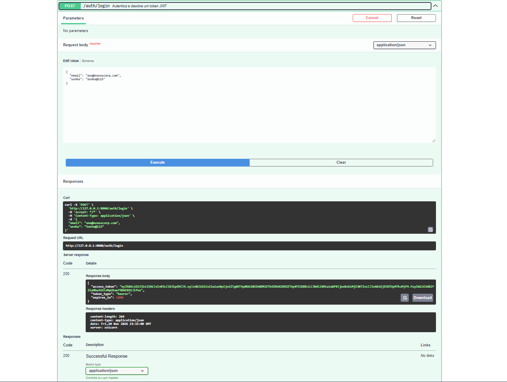
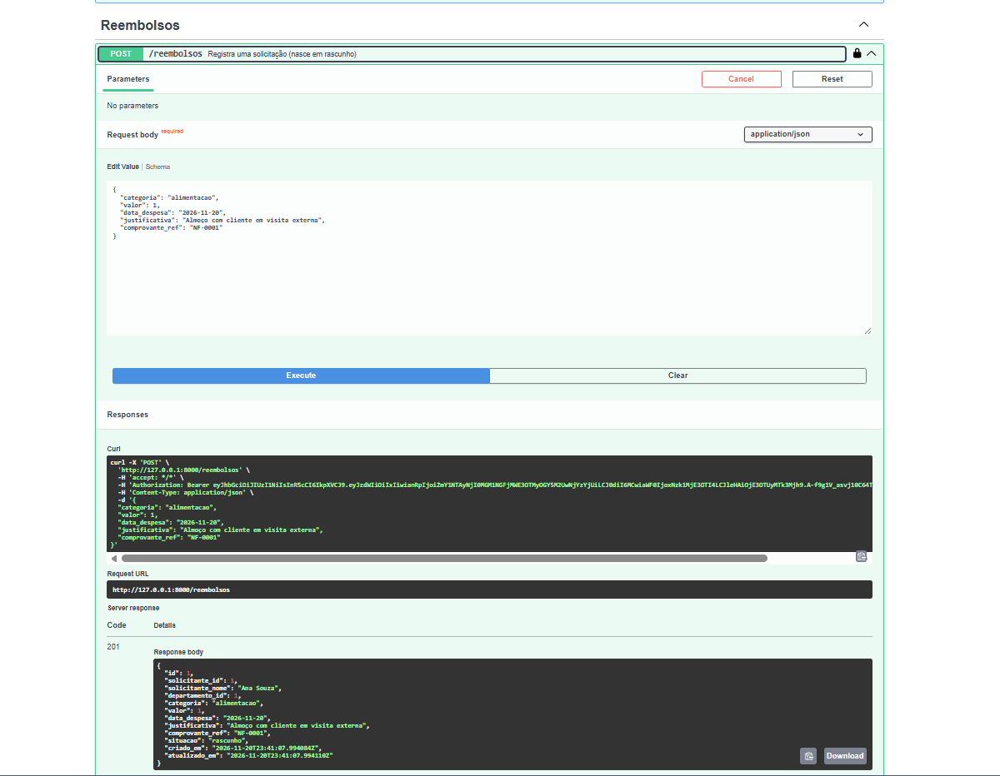
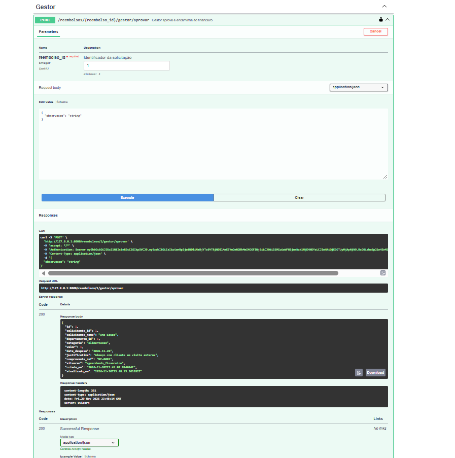
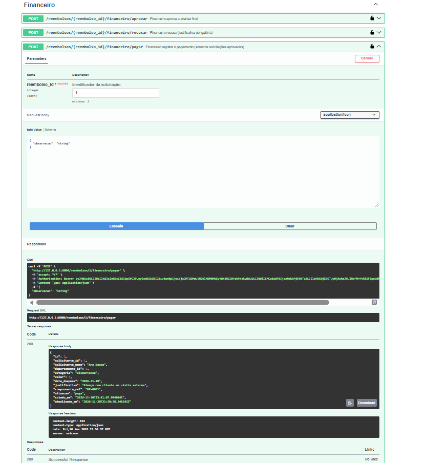
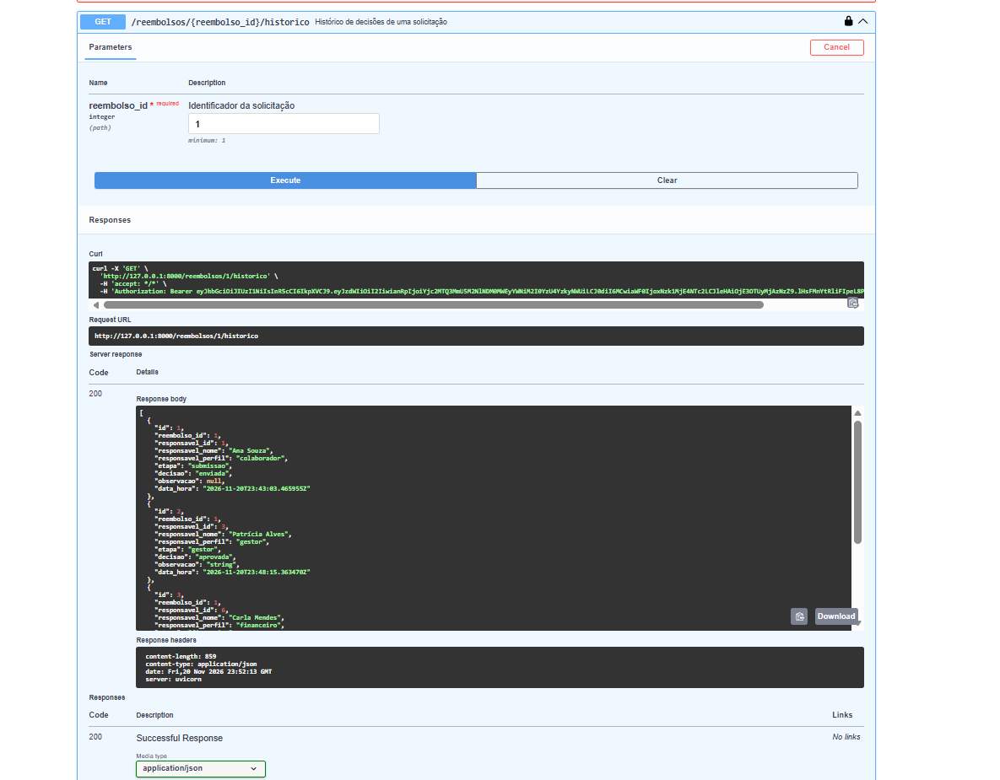
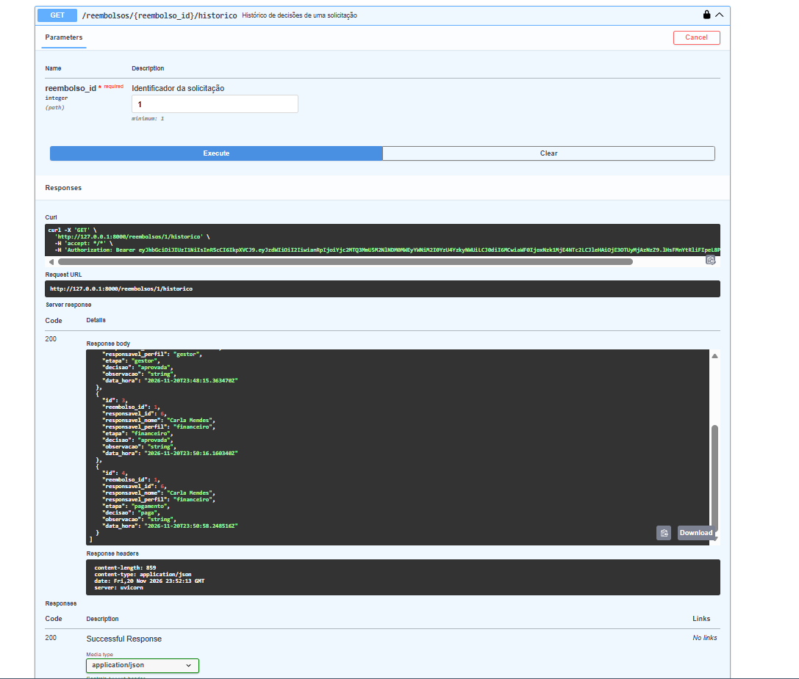
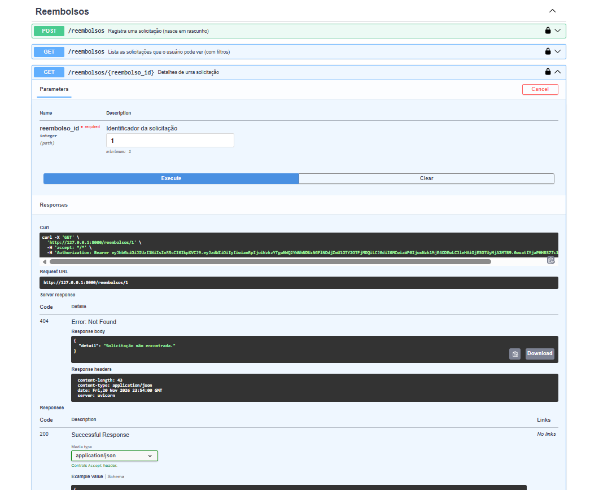
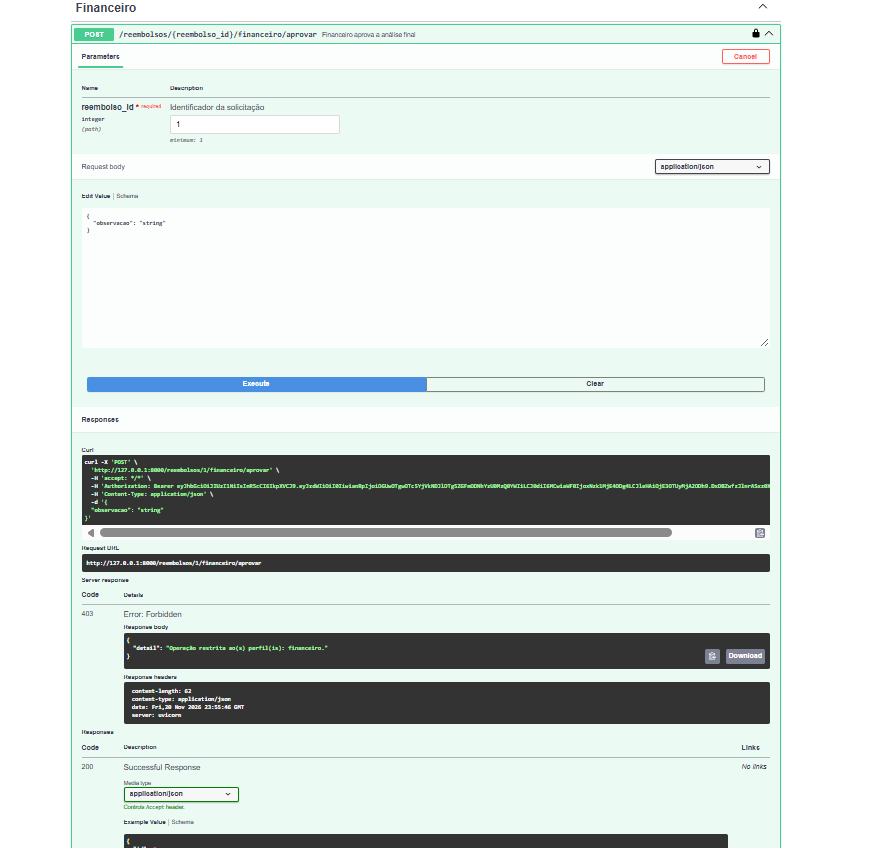
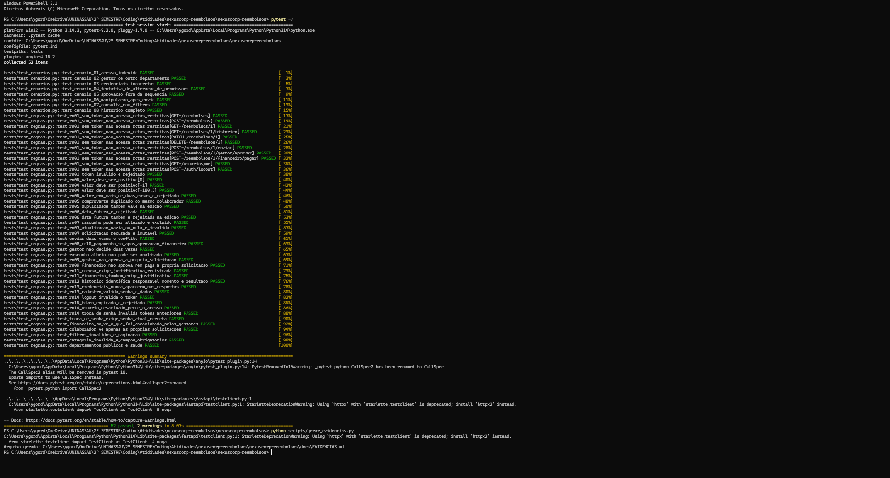

# NexusCorp — Plataforma de Gestão de Reembolsos Corporativos

API REST em **FastAPI + SQLModel + SQLite** com autenticação JWT, controle de acesso por perfil
(colaborador, gestor, financeiro), fluxo de aprovação e histórico rastreável.

**Atividade 07 — 2AV** · Ygor da Silva Allves · Matrícula 01902390

## Como executar

```bash
python -m venv .venv
# Linux/macOS:  source .venv/bin/activate      Windows:  .venv\Scripts\activate
pip install -r requirements.txt

cp .env.example .env        # defina SECRET_KEY (instruções dentro do arquivo)
python -m app.seed demo     # cria departamentos e usuários de demonstração
uvicorn app.main:app --reload
```

- Swagger (documentação interativa): http://127.0.0.1:8000/docs
- No Swagger: `POST /auth/login` → copie o `access_token` → botão **Authorize**.

### Usuários de demonstração (senha de todos: `Senha@123`)

| E-mail | Perfil | Departamento |
|---|---|---|
| ana@nexuscorp.com | colaborador | Comercial |
| bruno@nexuscorp.com | colaborador | Tecnologia |
| patricia@nexuscorp.com | gestor | Comercial |
| tiago@nexuscorp.com | gestor | Tecnologia |
| gabriel@nexuscorp.com | gestor | Financeiro |
| carla@nexuscorp.com | financeiro | Financeiro |
| fabio@nexuscorp.com | financeiro | Financeiro |

Gestores e financeiro **não** podem ser criados pela API (RN15). Para criar um novo:

```bash
python -m app.seed criar-usuario --nome "Maria" --email maria@empresa.com --perfil gestor --departamento Comercial
```

## Testes e evidências

```bash
pytest -v                                   # 8 cenários de homologação + regras RN01–RN15
python scripts/gerar_evidencias.py          # gera docs/EVIDENCIAS.md com requisições e respostas reais
pytest -v | tee docs/evidencias_pytest.txt  # (opcional) salva a saída dos testes
```

## Documentação

- [`docs/DOCUMENTACAO.md`](docs/DOCUMENTACAO.md): solução, modelo de dados, contratos, matriz de permissões, regras de negócio e decisões de segurança.
- [`docs/EVIDENCIAS.md`](docs/EVIDENCIAS.md): evidências de execução (gerado pelo script).

## Evidências de execução

Além de `docs/EVIDENCIAS.md` (gerado por `scripts/gerar_evidencias.py`, com os 8 cenários) e da
saída dos testes (`docs/evidencias_pytest.txt`), seguem os prints da API em execução no Swagger.

**Fluxo completo de aprovação (Ana → Patrícia → Carla)**

| Etapa | Evidência |
|---|---|
| 1. Login da Ana (200, token JWT) |  |
| 2. Ana registra a solicitação (201, situação `rascunho`) |  |
| 3. Patrícia (gestora) aprova (200, situação `aguardando_financeiro`) |  |
| 4. Carla (financeiro) registra o pagamento (200, situação `paga`) |  |
| 5. Histórico: início (envio e aprovação do gestor) |  |
| 5. Histórico: fim (aprovação financeira e pagamento, com os responsáveis) |  |

**Tentativas não autorizadas**

| Tentativa | Resultado | Evidência |
|---|---|---|
| Consultar solicitação fora do seu escopo (RN02) | 404, sem revelar dados |  |
| Usuário sem o perfil financeiro tenta aprovar como financeiro | 403 |  |

**Testes automatizados:** 52 testes passando.



## Publicar no GitHub

```bash
git init
git add .
git commit -m "API de gestão de reembolsos - Atividade 07"
git branch -M main
git remote add origin https://github.com/<seu-usuario>/<repositorio>.git
git push -u origin main
```

O `.gitignore` já exclui `.env`, `.venv` e `*.db`.
